# HOPPER

A Commodore 64 version of *Hopper*, the *Frogger*-style arcade game A.J. Clarke wrote for the Oric-1 and Personal
Software Services (PSS) of Coventry published on cassette in 1983. The C64 version runs the original game code, every
byte at its Oric address, on a new C64 platform layer, in two looks: **Classic** and **Enhanced**.

The Oric original is here too. `original/HOPPER.TAP` is the 1983 tape, and `src/hopper.s` is its full, commented 6502
source, which `make verify` assembles with cc65 back into a tape byte-identical to the original, ready to load in any
Oric emulator (`make run` starts it in Auric).

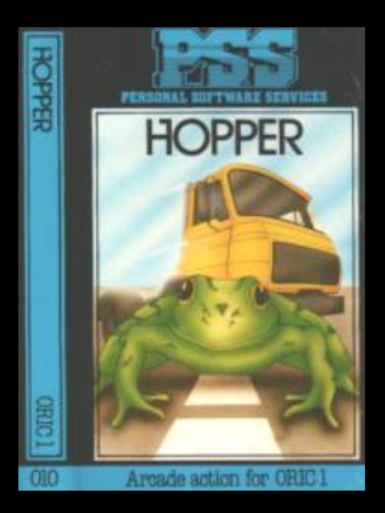

---

## The Game

The player guides five frogs, one at a time, from the bank at the bottom of the screen into the five homes in the hedge
at the top. First comes a three-lane road of cars and trucks, then a middle bank with a snake on it, then a river: a
frog hops onto the logs and the turtles (which dive now and then) and rides them across, without falling in or being
carried off the edge of the screen. One TIME counter covers the whole sheet, and every hop, frog home and fly eaten
scores. Five frogs home clears the sheet, and the next one is faster; from sheet 3 a fly sits in an empty home for a
bonus. The player has five lives, and the best eight scores go on the hi-score table.

| Keys (C64)      | Does                                                         |
|:----------------|:-------------------------------------------------------------|
| Z X K M         | Left, right, up, down; or redefined keys; or joystick port 2 |
| P               | Pause                                                        |
| RUN/STOP        | End the game                                                 |
| 1               | Start a game                                                 |
| 3               | Redefine the keys (on the instructions or hi-score screen)   |
| F1              | Classic or Enhanced (on the instructions page)               |
| RESTORE         | The Oric's RESET: back to the sound menu                     |

The full rules, lanes, scoring and sheets are in the [player's guide](docs/player_guide.md).

---

## Screenshots

The Oric original, drawn by the game's own code:

| Play                                                 | Hi-scores                                                    |
|:-----------------------------------------------------|:-------------------------------------------------------------|
| 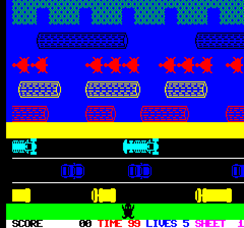 | 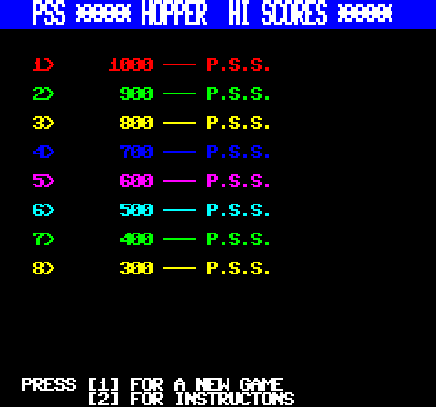 |

The C64 version, in its two looks:

| C64 Classic                                                   | C64 Enhanced                                                       |
|:--------------------------------------------------------------|:-------------------------------------------------------------------|
| 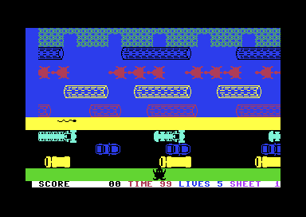                | 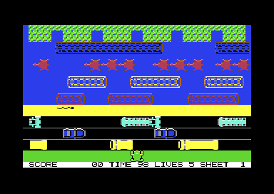                |
| 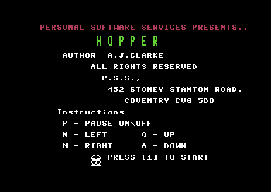 | 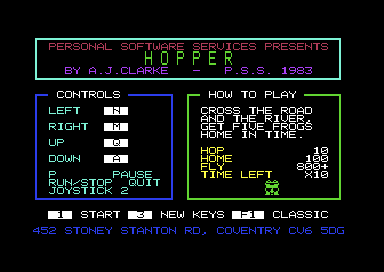 |
| 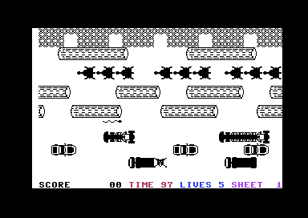     | 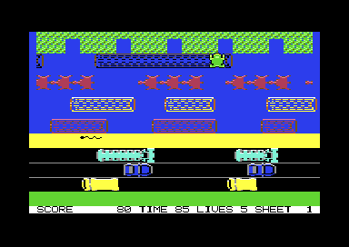   |
| 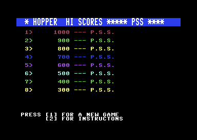   | 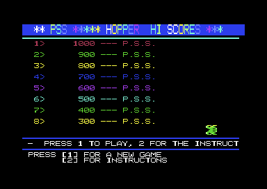 |

| The C64 start-up picture                                   | Enhanced: smooth-scrolling lanes                         |
|:-----------------------------------------------------------|:---------------------------------------------------------|
| 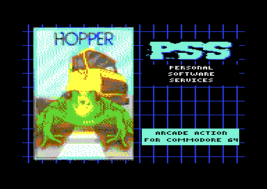 | 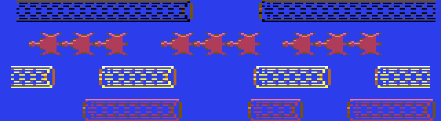 |

---

## The Versions

| Version             | Machine | What it is                                                        |
|:--------------------|:--------|:------------------------------------------------------------------|
| Oric original (1.0) | Oric-1  | The 1983 tape, rebuilt byte for byte; never changed               |
| C64 Classic         | C64     | The Oric game and look, with a short list of C64 Remix changes    |
| C64 Enhanced        | C64     | The same game with a C64 look: multicolour, sprites, smooth lanes |

The Oric original is the reference: `make verify` rebuilds `build/HOPPER.TAP` from `src/hopper.s` and compares it
with `original/HOPPER.TAP`, and `make run` loads it in Auric in Oric-1 mode. Both C64 looks come from the one
`hopper.prg`.

**Classic** draws the game as the Oric does, in the C64 font, with the AY's tunes on the SID. The **C64 Remix** adds a
few deliberate changes: redefinable keys, the Z X K M key set, the joystick, a start-up picture made from the cassette
cover, the frog reaching the outermost columns, RUN/STOP to end a game and a fix for a hang the Oric code causes on a
C64 ([remix.md](docs/remix.md) lists each one). **Enhanced** plays exactly like Classic, same code, timings and
collisions, but uses the C64 hardware Classic leaves idle: multicolour lanes and road markings, a sprite frog and fly
with gliding hops, smooth-scrolling lanes, an Oric-style font, its own instructions page and a livelier hi-score screen
([enhanced.md](docs/enhanced.md)).

---

## History

A.J. Clarke wrote *Hopper* for the Oric-1, and PSS (452 Stoney Stanton Road, Coventry) sold it on cassette in 1983 at
£6.95, catalogue number 010, alongside [*Light Cycle*](https://github.com/anthonyjclarke/Light-Cycle-Oric) by the same
author. The PSS advert called it an all machine code version of *Frogger*, with variable-speed traffic, snakes, diving
turtles, fleas, logs, a decreasing time limit, ever-increasing speed, a hi-score table, full colour and sound
([original_release.md](docs/original_release.md)).

The Oric-1 came from Oric Products International, set up by Tangerine Computer Systems of Cambridgeshire: a 1 MHz 6502,
a 6522 VIA, an AY-3-8912 sound chip and a 40×28 text screen whose colours are set by attribute bytes in the text
itself. It sold well in the UK and especially in France ([oric_history.md](docs/oric_history.md)).

---

## Behind the Scenes

This project starts from the tape image (`original/HOPPER.TAP`): it disassembled it, named and commented every
routine, and rebuilt it with cc65 until `make verify` reproduced the tape byte for byte. The C64 version runs that same
Oric code, every byte at its Oric address, on a small platform layer that stands in for the Oric's screen, sound chip,
keyboard and timers.

The builds need cc65 (`brew install cc65`) and Python 3; VICE runs the C64 version and Auric the Oric one.

```bash
make verify
```

```bash
make c64-run
```

`make verify` builds `build/HOPPER.TAP` and checks it against the original; `make c64-run` builds
`c64/build/hopper.prg` and starts it in VICE (`make c64-d64` for a disk image, `make run` for the Oric build in Auric).

| Document                                    | For                                                        |
|:--------------------------------------------|:-----------------------------------------------------------|
| [docs/HOPPER.html](docs/HOPPER.html)        | Every chapter in one offline page, images and audio inside |
| [docs/README.md](docs/README.md)            | The list of chapters                                       |
| [source_guide.md](docs/source_guide.md)     | Repository layout, toolchain, build targets, conventions   |
| [architecture.md](docs/architecture.md)     | Boot, memory map, the main loop, timing                    |
| [quirks.md](docs/quirks.md)                 | Bugs and oddities found in the original                    |
| [porting.md](docs/porting.md)               | How the C64 version was made                               |
| [CHANGELOG.md](CHANGELOG.md)                | Release history                                            |

The C64 start-up picture is `c64/art/intro.png`, made to be edited by hand ([porting.md](docs/porting.md)).
