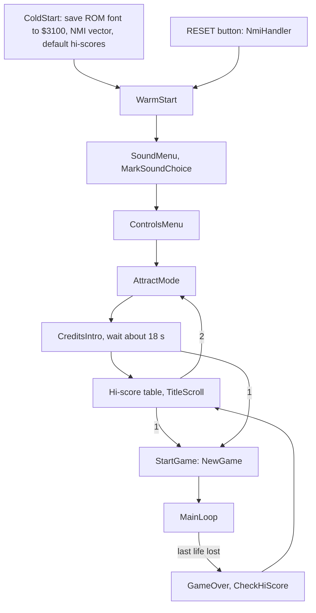

# Hopper – Architecture

This is how the game is put together, read from `src/hopper.s`. The C64 side is in [porting.md](porting.md) and
[platform_layer.md](platform_layer.md).

---

## The Tape

`original/HOPPER.TAP` holds one machine-code block, `$0500`–`$30D4`, flagged to autorun at `$0500`. There's no BASIC
loader and no second block. The build writes the same 14-byte TAP header from the `TAPEHDR` segment
([source_guide.md](source_guide.md)).

---

## Memory Map (Oric)

| Address         | Contents                                                       |
|:----------------|:---------------------------------------------------------------|
| `$0000`–`$005C` | Zero page: temporaries, frog, lanes, snake, sound (`vars.inc`) |
| `$00D0`–`$00D3` | Random seed `rand_seed`                                        |
| `$00FF`         | `sound_mode`                                                   |
| `$0200`–`$02FF` | Oric-1 ROM variables used directly (below)                     |
| `$0400`–`$0462` | Game variables: spawners, sheet, frog row, turtles, speeds     |
| `$0500`–`$05CB` | `ColdStart`, `WarmStart`, `NmiHandler`, `CheckPause`           |
| `$0600`–`$0947` | Character graphics, colours, lane data, sound tables           |
| `$0948`–`$2206` | Game code, with small tables between routines                  |
| `$22FF`–`$23FE` | Default hi-score table (`hiscore_init`)                        |
| `$2400`–`$2771` | Credits and instructions text, and the hop path                |
| `$2778`–`$2BF9` | Attract mode, the fly, the music player                        |
| `$2C00`–`$2F29` | In-game tunes and the sound menu text                          |
| `$2F30`–`$30D4` | Controls menu, status save, sheet tune, `MarkSoundChoice`      |
| `$3100`–`$33FF` | The ROM font, saved at cold start                              |
| `$B400`–`$B7FF` | Character set, partly redefined                                |
| `$BA00`–`$BAFF` | Hi-score table, in the unused alternate character set          |
| `$BB80`–`$BFDF` | Text screen, 40×28; row 27 is the status line                  |

Most routines start on round addresses (`$0A00`, `$1000`, `$1400`, …), with `$FF`, `$55` or `$EA` filling the gaps. That
suggests the game was assembled by hand into a monitor rather than with an assembler.

### Oric-1 ROM Locations

The game reads and writes the Oric-1 ROM's variables directly, so it needs the Oric-1 ROM (v1.0). The Atmos keeps them
elsewhere.

| Address | Name         | Use                                                                          |
|:--------|:-------------|:-----------------------------------------------------------------------------|
| `$022B` | `NMI_VECTOR` | The RESET button's `JMP`; `ColdStart` points it at `NmiHandler`              |
| `$02DF` | `ROM_KEY`    | The ROM interrupt's last key, bit 7 set when new (menus, names)              |
| `$12`   | `ROM_CURPTR` | The ROM cursor's screen address; set to `$C0C0` so its blink writes into ROM |
| `$0269` | `ROM_CURCOL` | The cursor column, for the name entry                                        |

---

## Start-Up

`ColdStart` runs once, from the tape. `WarmStart` is also where the RESET button lands. `NmiHandler` clears the screen,
puts the ROM font back, silences the AY, waits about two seconds and goes to `WarmStart`, so a reset keeps the
hi-scores. If `key_state` reads `$28` during those two seconds it jumps to `$A800` instead ([quirks.md](quirks.md)).

---

## The Main Loop

`NewGame` masks interrupts (`sei`) and calls `InitGame`. `NewLife` resets the stack, and every death and frog home jumps
back there. Each pass of `MainLoop` runs through these steps:

1. `FlyWarble`, `UpdateFly`: the fly's sound and its timer (from sheet 3).
2. `CheckFrogBounds`, `MoveFrog`, `CheckFrogBounds`: read a move, hop, check what the frog landed on, score.
3. `FrameDelay`: the frame's wait, servicing the timer.
4. `CheckTurtleDive`, `MusicTick`, `CheckPause`.
5. The seven lanes, river first: each lane's timer counts to its speed in `lane_speeds`, then the lane scrolls one
   column; river lanes carry the frog (`CarryFrog`), road lanes take the frog off the screen, scroll and spawn
   (`EraseFrogIfRoad`, `SpawnRow17` …, `RedrawFrogIfRoad`). `ServiceTimer` runs after each lane.
6. `MoveSnake` every 8th pass, `AnimateTurtles` every 32nd from sheet 2 (masks `snake_speed`, `turtle_speed`).

Collision works on screen contents. A road cell that isn't a space kills the frog, and a river cell that is a space
drowns it. The four cells under the frog are kept in `under_frog` while it's drawn over them.

---

## Timing

Two clocks run the game.

| Clock        | Period                   | Drives                                                    |
|:-------------|:-------------------------|:----------------------------------------------------------|
| `FrameDelay` | `game_delay` × 256 loops | The frame: 13 × ~1.8 ms ≈ 24 ms of waiting, ~30 ms a pass |
| VIA timer 2  | `$606B` µs (24.7 ms)     | `ServiceTimer`: TIME every 32 periods (0.79 s), hop sound |

`ServiceTimer` polls the VIA's timer 2 flag, so it runs from `FrameDelay`, `DelayX` and the lane loop rather than from
an interrupt. Lanes move every 5–13 frames to start with, and the speed-ups lower `lane_speeds` (to 3 at least) and, every
eighth sheet, `game_delay` ([player_guide.md](player_guide.md#sheets)).

### Interrupts

In the menus and the attract cycle the Oric ROM's own interrupt runs (VIA timer 1, about 100 Hz, set up by
`InitTimers`). It scans the keyboard into `ROM_KEY` and blinks the cursor, which the game has pointed into ROM. For play,
`NewGame` masks it, and `ReadKeys` scans the five control keys itself through the VIA and the AY's I/O port.

---

## The C64

The C64 version runs this same code at the same addresses, with the hardware calls patched to a platform layer. The Oric
screen at `$BB80` is copied to the VIC-II, the AY writes go to the SID, the keys come from the CIA, and both clocks are
timed on a CIA. The raster interrupt keeps running through play, so the `sei` at `NewGame` became a `nop`
([porting.md](porting.md)).
