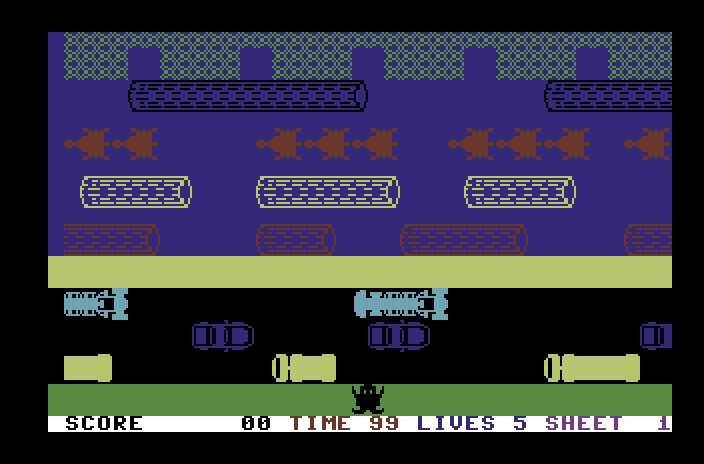
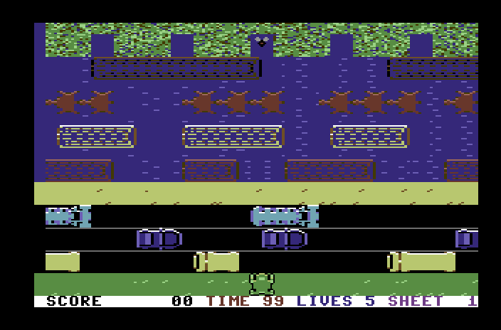
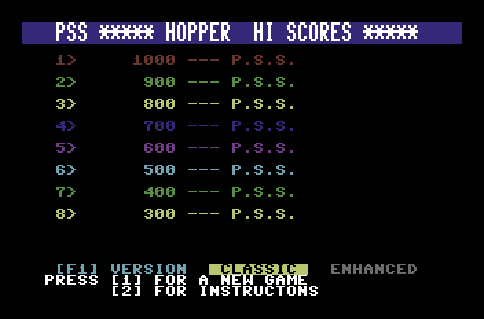
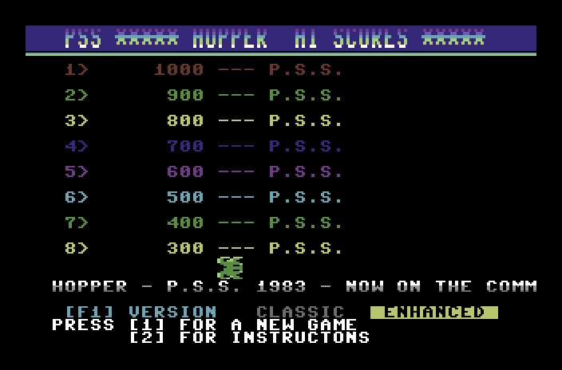
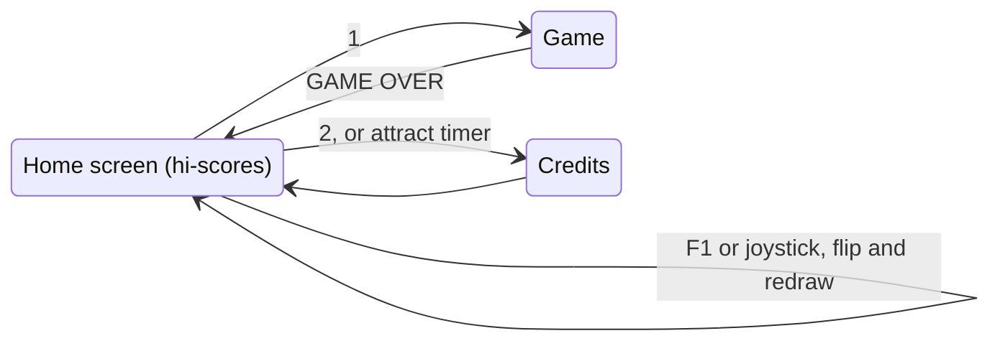

# Hopper – C64 Enhanced

The C64 Enhanced version is a second look for the Commodore 64 game. It plays exactly like the port: same lanes,
timings, collisions and scoring, because it runs the same Oric code. What changes is how the game looks and sounds. It
uses the C64 hardware the port leaves idle: sprites, multicolour characters, the raster interrupt beyond paper colours,
the SID's filter and envelopes, and about 16 KB of free memory. The player chooses **Classic** or **Enhanced** on the
home screen and can switch back and forth between games.

**Status: planned.** Nothing in this section is built yet. The pictures are mock-ups drawn by
`docs/tools/render_enhanced.py` from the real game screens ([How the Mock-Ups Are Made](#how-the-mock-ups-are-made)),
not VICE captures. Memory and cycle figures are estimates. This chapter is the overview and the version switch;
[enhanced_graphics.md](enhanced_graphics.md), [enhanced_sound.md](enhanced_sound.md) and
[enhanced_platform.md](enhanced_platform.md) describe each change in full.





---

## Ground Rules

**The game logic is untouched.** Every game byte stays the Oric's, at its Oric address, as in the port. The enhancements
live in the platform layer (`c64/src/`) and only read the game's state: `frog_row`, `frog_col`, `fly_on`, `fly_ptr`,
`turtle_frame` and the Oric screen at `$BB80`. Two small hooks copy graphics when the game changes its own glyphs
([enhanced_platform.md](enhanced_platform.md#hooks)). They change nothing the game reads.

**Pixels, not cells.** The game draws by writing character codes and tests collisions by reading them back
([architecture.md](architecture.md)). Enhanced changes only how those codes look on screen, so what the player sees can
never disagree with what the game tests. A sprite frog still has the frog's characters underneath it, and a textured
river is still spaces.

**Classic is today's port.** In Classic the C64 draws exactly what the current build draws. Classic `make c64-smoke`
captures must match today's captures. `make verify` is not affected, because `src/hopper.s` never changes. Any change to
`c64/src/hopper.s` is marked `; C64: (Enhanced)`, and gameplay changes stay in the C64 Remix ([remix.md](remix.md)):
Enhanced adds none.

**Subtle.** Each change keeps the original's shapes, colours and layout as its starting point. Logs keep their lane
colours, the frog keeps its drawing, and the screens keep their text where the game prints it.

---

## Summary of Changes

| ID | Change                        | Kind      | Tier     | Chapter                                      |
|:---|:------------------------------|:----------|:---------|:---------------------------------------------|
| V0 | Version switch on home screen | Front end | Polish   | [The Version Switch](#the-version-switch)    |
| V1 | Multicolour lane graphics     | Graphics  | Polish   | [enhanced_graphics.md](enhanced_graphics.md) |
| V6 | Road markings as raster lines | Graphics  | Polish   | [enhanced_graphics.md](enhanced_graphics.md) |
| V7 | Oric-style font               | Graphics  | Polish   | [enhanced_graphics.md](enhanced_graphics.md) |
| S1 | SID voicing of the AY tunes   | Sound     | Polish   | [enhanced_sound.md](enhanced_sound.md)       |
| V2 | Sprite frog with hop arc      | Graphics  | Showcase | [enhanced_graphics.md](enhanced_graphics.md) |
| V3 | Fly sprite                    | Graphics  | Showcase | [enhanced_graphics.md](enhanced_graphics.md) |
| V5 | Water and grass texture       | Graphics  | Showcase | [enhanced_graphics.md](enhanced_graphics.md) |
| F1 | Enhanced attract screen       | Front end | Showcase | [enhanced_graphics.md](enhanced_graphics.md) |
| S2 | SID sound effects             | Sound     | Showcase | [enhanced_sound.md](enhanced_sound.md)       |
| V4 | Smooth-scrolling lanes        | Graphics  | Stretch  | [enhanced_graphics.md](enhanced_graphics.md) |
| F2 | Hi-scores saved to disk       | Front end | Stretch  | [enhanced_platform.md](enhanced_platform.md) |
| S3 | Title tune                    | Sound     | Stretch  | [enhanced_sound.md](enhanced_sound.md)       |

**Polish** is low risk, gives the biggest change in a still screenshot, and needs only the two copy hooks. **Showcase**
uses sprites and the spare frame time and shows best in motion. Each **Stretch** item is self-contained and can be
dropped.

| Tier     | Memory (estimate) | Game bytes changed |
|:---------|:------------------|:-------------------|
| Polish   | 3.4 KB            | Two `jsr` hooks    |
| Showcase | 2.9 KB            | None               |
| Stretch  | 3.2 KB            | None               |

---

## The Version Switch

The hi-score screen is the home screen. Every game starts there and comes back there, through the attract loop or after
GAME OVER. In both versions it gains one line, on row 25, just above the game's own prompts:

```text
   [F1] VERSION   CLASSIC   ENHANCED
```

The chosen version sits in a yellow bar, the other in grey. Row 25 is blank on this screen in the original, and the
port's hi-score row map keeps it.





### Using It

| Input                  | Does                                            |
|:-----------------------|:------------------------------------------------|
| F1                     | Flip between Classic and Enhanced               |
| Joystick left or right | The same                                        |
| 1                      | Start a game in the chosen version (unchanged)  |
| 2                      | Credits and instructions, in the chosen version |

- The home screen redraws in the chosen style straight away. The player sees the difference before starting.
- Each flip restarts the 15-second attract timer (`titleSteps`), so the screen doesn't move on to the start-up picture
  while the player is choosing.
- The choice applies to everything after it: the game, the credits, the sheet-start signs, GAME OVER and the attract
  loop. It doesn't change in the middle of a game.
- It lasts until power-off. RESTORE, the Oric's RESET, keeps it, as it keeps the hi-scores. With disk hi-scores (F2) it
  is saved with them.
- A fresh power-up starts in Enhanced (an open question below).



### How It Works

`TitleTickC64` already stands in for the game's `jsr CheckMenuKeys` in `TitleScroll` (patched at `$2938`), so the new
key is read there, in platform code, without changing a game byte. One platform zero-page flag holds the choice. Every
enhancement tests it, and the raster interrupt picks each row's character set and colours from it. Both looks stay in
memory all the time, so a flip costs one redraw. The details are in
[enhanced_platform.md](enhanced_platform.md#the-version-flag).

F1 is free on that screen: the game's own keys there are 1 and 2. `RedefineKeys` must also refuse F1 as a movement key,
as it refuses P and SPACE today.

---

## Order of Work

1. **Polish:** V0 first, so that every later change is built and checked against Classic from the start. Then V7, V1, V6
   and S1.
2. **Showcase:** V2, V3, V5, F1 and S2.
3. **Stretch:** V4, F2 and S3, each optional. V4 starts with a timing study of the lane counters.

Each step ends with Classic smoke captures that match today's, and Enhanced captures added to the handbook.

---

## Open Questions

| Question                              | Proposal                                  |
|:--------------------------------------|:------------------------------------------|
| Name on the title screen and disk     | HOPPER+ or Hopper Enhanced                |
| Version at power-up                   | Enhanced                                  |
| Is a title tune "subtle" (S3)?        | Arranged from the sheet tune, or left out |
| Version switch in the sound menu too? | No: home screen only                      |
| Switch during a game (paused)?        | No: between games only                    |

---

## How the Mock-Ups Are Made

`docs/tools/render_enhanced.py` (`just docs-graphics`) builds every picture in this section from the tape. The game's
own routines draw the screens on the 6502 core (`tools/oric_screens.py`, as for the Oric figures in
[graphics.md](graphics.md)). The script then shows them the way the port does, with the same rows hidden, glyphs widened
from 6 to 8 pixels and the C64 font. On top of that it applies each enhancement as these chapters describe it. Colours
use the Pepto palette, so they differ a little from the VICE captures in [graphics.md](graphics.md), which use VICE's
default palette. When a change is built, its VICE capture replaces the mock-up.
