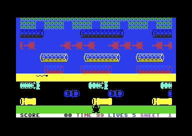
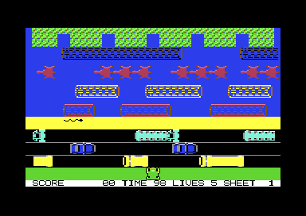
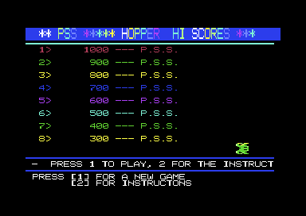
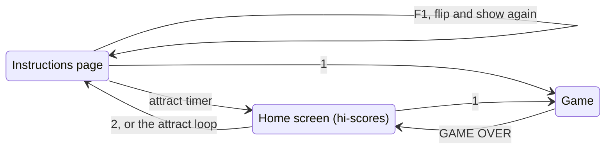

# Hopper – C64 Enhanced

The C64 Enhanced version is a second look for the Commodore 64 game. It plays exactly like the port: same lanes,
timings, collisions and scoring, because it runs the same Oric code. What changes is how the game looks and sounds. It
uses the C64 hardware the port leaves idle: sprites, multicolour characters, the raster interrupt beyond paper colours,
the SID's filter and envelopes, and about 16 KB of free memory. The player chooses **Classic** or **Enhanced** with F1
on the instructions page and can switch back and forth between games.

**Status.** Built and checked in VICE: the version switch (V0), the attract screen (F1), the instructions page (F3), the
multicolour lanes (V1), the sprite frog and fly (V2, V3), the smooth lanes (V4), the road markings (V6) and the Oric-style font (V7); their
pictures are VICE captures. Everything else is planned, and its pictures are mock-ups drawn by
`docs/tools/render_enhanced.py` from the real game screens ([How the Mock-Ups Are Made](#how-the-mock-ups-are-made)).
Memory and cycle figures for the planned changes are estimates. This chapter is the overview and the version switch;
[enhanced_graphics.md](enhanced_graphics.md), [enhanced_sound.md](enhanced_sound.md) and
[enhanced_platform.md](enhanced_platform.md) describe each change in full.






---

## Ground Rules

**The game logic is untouched.** Every game byte stays the Oric's, at its Oric address, as in the port. The enhancements
live in the platform layer (`c64/src/`) and only read the game's state: `frog_row`, `frog_col`, `fly_on`, `fly_ptr`,
`turtle_frame` and the Oric screen at `$BB80`. So far no game byte is patched for Enhanced: even the glyphs the game
rewrites while it plays are noticed by the platform ([enhanced_platform.md](enhanced_platform.md#hooks)).

**Pixels, not cells.** The game draws by writing character codes and tests collisions by reading them back
([architecture.md](architecture.md)). Enhanced changes only how those codes look on screen, so what the player sees can
never disagree with what the game tests. A sprite frog still has the frog's characters underneath it, and a textured
river is still spaces.

**Classic is today's port.** In Classic the C64 draws exactly what the port draws: every Enhanced cost sits behind a
flag, so Classic runs the same code paths, give or take a few cycles. Those cycles can move a capture by a frame, so
Classic captures are checked by eye against the last build rather than byte for byte. `make verify` is not affected,
because `src/hopper.s` never changes. Any change to `c64/src/hopper.s` is marked `; C64: (Enhanced)`, and gameplay
changes stay in the C64 Remix ([remix.md](remix.md)): Enhanced adds none.

**Subtle.** Each change keeps the original's shapes, colours and layout as its starting point. Logs keep their lane
colours, the frog keeps its drawing, and the screens keep their text where the game prints it.

---

## Summary of Changes

| ID | Change                        | Kind      | Tier     | Chapter                                      | Status  |
|:---|:------------------------------|:----------|:---------|:---------------------------------------------|:--------|
| V0 | Version switch (F1)           | Front end | Polish   | [The Version Switch](#the-version-switch)    | Built   |
| F3 | Enhanced instructions page    | Front end | Polish   | [enhanced_graphics.md](enhanced_graphics.md) | Built   |
| V1 | Multicolour lane graphics     | Graphics  | Polish   | [enhanced_graphics.md](enhanced_graphics.md) | Built   |
| V6 | Road markings as raster lines | Graphics  | Polish   | [enhanced_graphics.md](enhanced_graphics.md) | Built   |
| V7 | Oric-style font               | Graphics  | Polish   | [enhanced_graphics.md](enhanced_graphics.md) | Built   |
| S1 | SID voicing of the AY tunes   | Sound     | Polish   | [enhanced_sound.md](enhanced_sound.md)       | Planned |
| V2 | Sprite frog with hop arc      | Graphics  | Showcase | [enhanced_graphics.md](enhanced_graphics.md) | Built   |
| V3 | Fly sprite                    | Graphics  | Showcase | [enhanced_graphics.md](enhanced_graphics.md) | Built   |
| V5 | Water and grass texture       | Graphics  | Showcase | [enhanced_graphics.md](enhanced_graphics.md) | Planned |
| F1 | Enhanced attract screen       | Front end | Showcase | [enhanced_graphics.md](enhanced_graphics.md) | Built   |
| S2 | SID sound effects             | Sound     | Showcase | [enhanced_sound.md](enhanced_sound.md)       | Planned |
| V4 | Smooth-scrolling lanes        | Graphics  | Stretch  | [enhanced_graphics.md](enhanced_graphics.md) | Built   |
| F2 | Hi-scores saved to disk       | Front end | Stretch  | [enhanced_platform.md](enhanced_platform.md) | Planned |
| S3 | Title tune                    | Sound     | Stretch  | [enhanced_sound.md](enhanced_sound.md)       | Planned |

**Polish** is low risk and gives the biggest change in a still screenshot; V1 turned out to need no game hooks.
**Showcase** uses sprites and the spare frame time and shows best in motion. Each **Stretch** item is self-contained and
can be dropped.

| Tier     | Memory (estimate) | Game bytes changed |
|:---------|:------------------|:-------------------|
| Polish   | 3.4 KB            | None               |
| Showcase | 2.9 KB            | None               |
| Stretch  | 3.2 KB            | None               |

---

## The Version Switch

The switch lives on the credits and instructions page, the one screen that lists the keys. F1 there flips between
Classic and Enhanced and shows the page again in the chosen look, so the player sees the difference before starting.
F1 does nothing on any other screen.

In Classic the page is the original: a frog hops round the screen laying the text down, then the version line appears
on row 17. In Enhanced it is layout C, drawn at once: a framed title, CONTROLS and HOW TO PLAY panels with keycaps, and
the 1, 3 and F1 buttons ([enhanced_graphics.md](enhanced_graphics.md#f3--enhanced-instructions-page)).

```text
   [F1] VERSION   CLASSIC   ENHANCED
```

Classic's version line, under the address once the frog has laid the page down: `[F1] VERSION` in cyan, the chosen
version in an inverse bar (black on white), the other in blue. Enhanced's page has an `F1` keycap marked `CLASSIC`
beside the 1 and 3 buttons.


The hi-score screen is the original's in Classic; in Enhanced it is the attract screen (F1): a colour-cycled title, a
scroller and a hopping frog ([enhanced_graphics.md](enhanced_graphics.md#f1--enhanced-attract-screen)).




### Using It

| Input | On the instructions page does                               |
|:------|:------------------------------------------------------------|
| F1    | Flip between Classic and Enhanced, and show the page again  |
| 1     | Start a game in the chosen version (unchanged)              |
| 2     | The page again                                              |
| 3     | Redefine the keys ([remix.md](remix.md))                    |

- Classic's page takes F1 once the frog has laid it down (the version line is up); Enhanced's at once.
- A flip shows the page again from the start, with the attract timer: Classic's frog walk, or Enhanced's page.
- The choice applies to everything after it: the game, the sheet-start signs, GAME OVER and the attract loop. It
  doesn't change in the middle of a game.
- It lasts until power-off. RESTORE, the Oric's RESET, keeps it, as it keeps the hi-scores. With disk hi-scores (F2) it
  is saved with them.
- A fresh power-up starts in Enhanced (`Start` sets it; an open question below).



### How It Works

One platform zero-page flag holds the choice and every enhancement tests it. F1 is taken out of the key buffer on every
screen, so no game key wait sees it, and flips only while the instructions page is up; `RedefineKeys` refuses it as a
movement key, and in a game it does nothing. The details are in
[enhanced_platform.md](enhanced_platform.md#the-version-flag).

---

## Order of Work

1. **Polish:** V0 first, so that every later change is built and checked against Classic from the start. Then V7, V1, V6
   and S1.
2. **Showcase:** V2, V3, V5, F1 and S2.
3. **Stretch:** V4 (built), F2 and S3, each optional.

Each step ends with Classic smoke captures that match today's, and Enhanced captures added to the handbook.

---

## Open Questions

| Question                              | Proposal                                  |
|:--------------------------------------|:------------------------------------------|
| Name on the title screen and disk     | HOPPER+ or Hopper Enhanced                |
| Version at power-up                   | Enhanced                                  |
| Is a title tune "subtle" (S3)?        | Arranged from the sheet tune, or left out |
| Version switch on other screens?      | No: the instructions page only            |
| Switch during a game (paused)?        | No: between games only                    |

---

## How the Mock-Ups Are Made

`docs/tools/render_enhanced.py` (`just docs-graphics`) builds every picture in this section from the tape. The game's
own routines draw the screens on the 6502 core (`tools/oric_screens.py`, as for the Oric figures in
[graphics.md](graphics.md)). The script then shows them the way the port does, with the same rows hidden, glyphs widened
from 6 to 8 pixels and the C64 font. On top of that it applies each enhancement as these chapters describe it. Colours
use the Pepto palette, so they differ a little from the VICE captures in [graphics.md](graphics.md), which use VICE's
default palette. When a change is built, its VICE capture replaces the mock-up.
