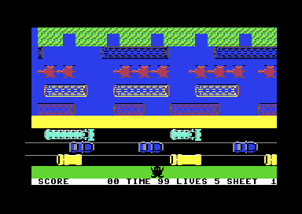
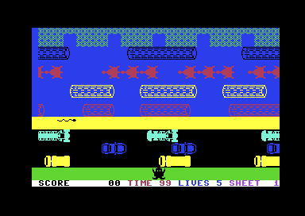
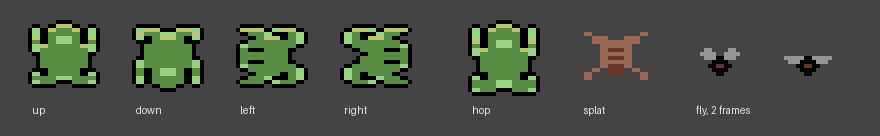
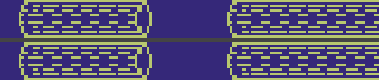

# Hopper – Enhanced Graphics

Every visual change in the C64 Enhanced version ([enhanced.md](enhanced.md)), one section per change: what the player
sees, what it is made from, and how the platform layer shows it. All of this is planned. The pictures are mock-ups drawn
from the real game screens by `docs/tools/render_enhanced.py` ([enhanced.md](enhanced.md#how-the-mock-ups-are-made)).
Where the change touches the platform layer, the routines are described in [enhanced_platform.md](enhanced_platform.md).

---

## What Stays the Same

The screen layout, the text and where it is printed, the lane colours, the frog's drawing and every shape the game
defines in `udg_graphics`, `udg_symbols`, `frog_gfx`, `home_gfx`, `splat_gfx` and `turtle_frames`. The 28 Oric rows are
still shown on 25, with the same rows hidden per screen ([porting.md](porting.md#decisions)). Text rows (the status
line, menus, credits, signs) stay hires. Enhanced redraws the graphics characters, adds sprites over them, and adds
colour to the background.

The close-up below shows several changes together: multicolour logs and cars, the river texture, tufts on the verge, and
the road markings between the car lanes.

---

## V1 – Multicolour Lane Graphics

**Built** (`c64/src/enhanced.s`), checked in VICE. Logs, turtles, trucks, cars and the hedge keep their shapes but gain
a shade and a highlight. Each lane keeps the ink the original gives it.

**How the graphics are made.** At the start of each Enhanced game the platform converts the game's own glyphs, as the
port draws them (6 pixels widened to 8), into a second character set at `CHARSET_MC` (`$8800`). Multicolour pixels go in
pairs. A pair with both pixels set takes the cell's colour RAM, which is the lane's ink. A pair with one pixel set takes
`$D022`, the shade. In the top row of characters of each lane, the topmost full pair in each pixel column takes `$D023`,
the highlight, so the top outline of a log or car catches the light and the grain inside it doesn't. The hedge
(character `$7F`) is the one drawn glyph: the original's dither pattern turns into stripes in multicolour, so it becomes
a leaf pattern. The conversion runs on the C64 (`McBuild`, `McChar`, about 30,000 cycles once per game), so there is no
generated data to keep in step with the game.

| Lane (rows)          | Ink (colour RAM) | Shade (`$D022`) | Highlight (`$D023`) |
|:---------------------|:-----------------|:----------------|:--------------------|
| Hedge (0–2)          | green            | light green     | brown               |
| Logs, black (4–5)    | black            | brown           | orange              |
| Turtles (7–8)        | red              | brown           | light red           |
| Logs, yellow (10–11) | yellow           | orange          | white               |
| Logs, red (13–14)    | red              | brown           | light red           |
| Trucks (17–18)       | cyan             | grey            | white               |
| Cars, blue (20–21)   | blue             | grey            | white               |
| Cars, yellow (23–24) | yellow           | grey            | white               |

The colours are `LaneShade` and `LaneLight` in `enhanced.s`, per Oric row. A multicolour cell's colour RAM can only take
colours 0–7, which are exactly the Oric's eight inks, so every lane keeps its own ink. The black logs therefore stay
black and get brown grain (an earlier plan made them brown, which colour RAM can't show). All three road lanes share
grey and white, so the raster interrupt's writes never change colours between two vehicles' rows.

**How it is shown.** In multicolour text mode a cell is multicolour only if its colour RAM is 8 or more. Text rows keep
colour RAM below 8 and stay hires, so while an Enhanced game is on (`zMcPlay`) the frame interrupt sets multicolour mode
for the whole screen. Lane rows are simple rows (attributes only in columns 0–1): when `FastRow` colours one, or
`ParseRow` finds one simple, `McRowSetup` gives it the ink + 8, the multicolour character set (`CS_MC`) and the lane's
shade and highlight (`rowMc1`, `rowMc2`). The raster interrupt already sets `$D021` and `$D018` at the end of each row,
and now sets `$D022` and `$D023` too.

**Keeping up with the game.** The game rewrites three groups of glyphs while it plays. The platform converts them again
when they change, so no game byte is patched. The two hooks the plan expected aren't needed:

| Glyphs                 | Rewritten by                         | Noticed by                          |
|:-----------------------|:-------------------------------------|:------------------------------------|
| Turtles `$6E`–`$73`    | `SetTurtleFrame`                     | `turtle_frame` changing             |
| Frog `$3A`–`$3D`       | `SetFrogGfx`, the splat, a home frog | Its 32 bytes, compared every pass   |
| Home frogs `$2B`–`$2F` | `DrawHomeFrog`                       | Compared every 8th pass             |
| Everything else        | `InitGame`                           | Sentinel glyphs `$21`, `$61`, `$75` |

`McDynamic` does this from `Present` and costs about 600 cycles a pass when nothing changed. The sentinels are there
because the set is first built when the play screen's row map is set, before `InitGame` copies the game's graphics in.

**The death flash** changes the papers in columns 0–1, so the lanes stay multicolour through it, on white or black
paper.

---

## V2 – Sprite Frog with Hop Arc

**What changes.** The frog becomes a sprite: a multicolour body (green, light green, yellow) with a hires black outline
sprite laid over it, so it stands out on the green verge and the yellow median. A hop is no longer an instant two-column
jump. Over about 140 ms the frog glides to its new place on a low arc, stretched by a row in mid-air. Death shows the
original splat as a sprite.

**How it is made.** The four directions come from `frog_gfx`, converted to multicolour as in V1. The outline is drawn
around them by the tool. The splat comes from `splat_gfx`. Each direction needs a body and an outline block for the
resting frame and the hop frame, so 16 sprite blocks.

**How it is shown.** The game still writes the frog's characters (`$3A`–`$3D`) into the screen and reads the cells under
them (`under_frog`), so collision is untouched. In the multicolour character set those four characters are blank. Each
frame, `UpdateSprites` places the sprite from `frog_row` and `frog_col`. When either changes, it tweens from the old
position to the new one over a few frames. On a log or turtle the frog moves with the lane in whole-character steps, as
the game moves it. With V4 it also takes the lane's fine scroll.

The frog never shares a row with more than one other sprite (the fly is in the home row), so no multiplexing is needed.

---

## V3 – Fly Sprite

**What changes.** The fly in a home flaps its wings (two frames) and bobs by a pixel. It appears where the game draws
its fly character, from `fly_ptr`, and goes when `fly_on` clears. The fly character stays on the screen for the game to
read.

---

## V5 – Water and Grass Texture

**What changes.** The river's empty water shows sparse light-blue ripples. The verges (the yellow median and the green
start) show small tufts. The ripples belong to the lane they are in, so they drift with the logs and turtles, and the
river looks like it flows. Every few frames the ripple glyphs swap between two phases, so they shimmer.

**How it is shown.** All of this is the space character (`$20`), which the game writes for open water and grass and
tests for drowning. `Present` translates `$20` per row as it copies the Oric screen: to a ripple character on river
rows, a tuft character on verge rows, and to itself elsewhere. The new glyphs use character codes `$00`–`$1F`. The Oric
never shows those codes as glyphs, because they are serial attributes, so they are free in the C64 character set. The
translation costs about 4,000 cycles a frame, inside the time the Oric spent waiting in `FrameDelay`
([porting.md](porting.md#decisions)).

---

## V6 – Road Markings

**Built**, checked in VICE. The Oric drew dashed lines between the car lanes on rows 19 and 22. The port hides those
rows to fit 28 rows on 25, so the three car lanes sit together. Enhanced draws a one-pixel grey line at each boundary
instead, without spending a row. It is solid, not dashed: a raster colour change covers the whole line.

**How it is shown.** The row interrupts for Oric rows 20 and 23 turn `$D021` grey for one raster line and back
([enhanced_platform.md](enhanced_platform.md#raster-interrupt)). Only the background takes the colour, so a car passing
over the line hides it, as a car would. The lines are drawn only while those rows show lanes, so the sheet-start signs,
which use the same rows, are left alone. The `enh-play` capture under V1 shows them.

---

## V7 – Oric-Style Font

**What changes.** The port shows text in the C64 font, because the Oric ROM font isn't on the tape
([porting.md](porting.md#known-differences)). Enhanced uses a new font drawn in the style of the Oric's: narrow letters,
6 pixels of design inside the 8-pixel cell, as the game's own glyphs are widened. The status line, menus, credits and
signs then read like the original.

**How it is shown.** `BuildFont` writes the new font into `CHARSET` instead of copying the C64 character ROM. It costs
no extra memory. The font is drawn for this project, not copied from the Oric ROM. Its design isn't made yet, so it has
no figure here.

---

## F1 – Enhanced Attract Screen

**What changes.** On the home screen ([enhanced.md](enhanced.md#the-version-switch)) the double-height title takes a
colour cycle, one colour per raster line pair, with thin raster bars above and below it. A sprite frog hops along the
empty rows 19 and 22. A smooth scroller runs on row 23. The hi-score table, the version line and the prompts stay where
they are printed.

**How it is shown.** The colour cycle and bars are raster interrupt changes on the title rows only. The scroller uses
the hidden-row trick in reverse: row 23 is blank in the game, so the platform owns it, and per-row `$D016` scrolls it.
The frog reuses the V2 sprites.

---

## V4 – Smooth-Scrolling Lanes

**What changes.** Lanes move pixel by pixel instead of eight pixels at a time. The game still moves each lane one
character per step. Between steps, each row is offset by 0–7 pixels with `$D016`, so the step lands where the scroll has
already reached.

**How it is shown.** Each lane steps every few frames (`lane_speeds`). The raster interrupt sets each lane row's fine
scroll from how far that lane is through its current wait. A lane that moves left counts down from 7 and one that moves
right counts up. The frog sprite on a log takes the same offset.

**Why it is a stretch.** The interrupt has to know when each lane will step next, which needs a study of the lane
counters and of the sheets that speed them up. The 38-column mode can't hide the ragged edge, because column 39 is
playfield, so the edge needs masking with sprites or a fixed blank column. If the step and the offset ever disagree, the
lane jitters, which looks worse than the port. If the study shows it can't be done cleanly, it is dropped.

---

## Memory for the Graphics

| Item                                    | Where           | Size                     |
|:----------------------------------------|:----------------|:-------------------------|
| Multicolour play character set (V1, V5) | `$8800`–`$8FFF` | 2,048 B                  |
| Multicolour turtle frames (V1)          | code area       | 336 B                    |
| Frog sprites, body and outline (V2)     | `$8400`–`$87FF` | 1,024 B                  |
| Splat, splash and fly sprites (V2, V3)  | `$B800`–`$B9FF` | 512 B                    |
| Oric-style font (V7)                    | `CHARSET`       | 0, replaces the C64 font |

The sprites and the character set must be where the VIC can see them in bank 2, and not in `$9000`–`$9FFF`, where the
VIC sees the character ROM ([enhanced_platform.md](enhanced_platform.md#memory)).
