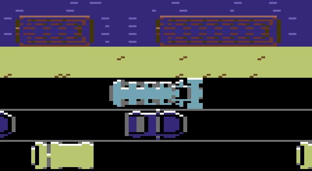
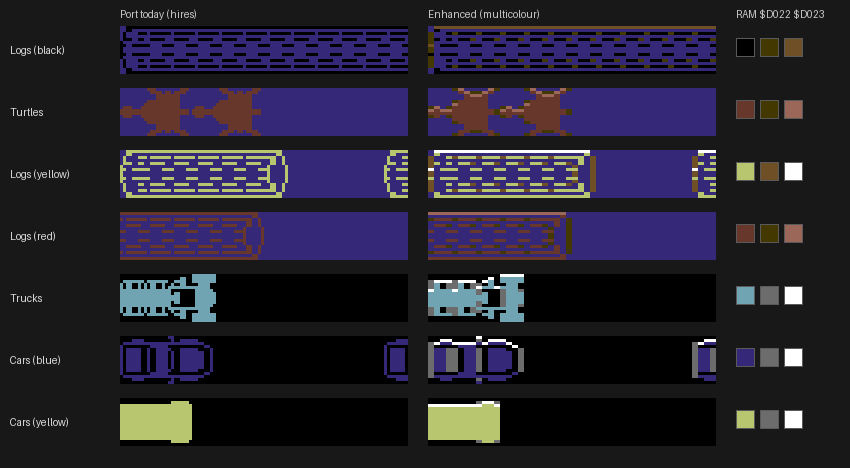
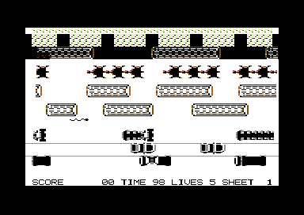
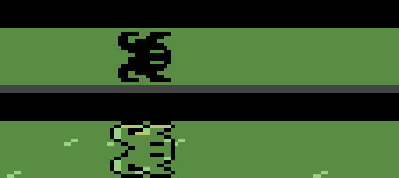
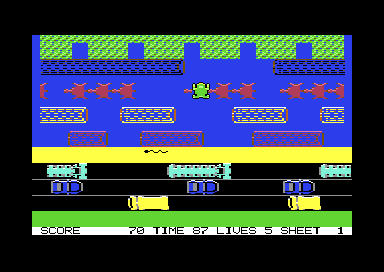
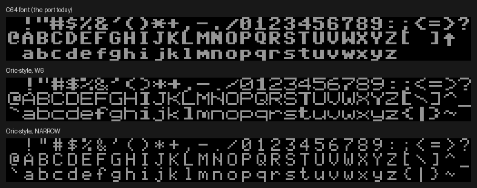
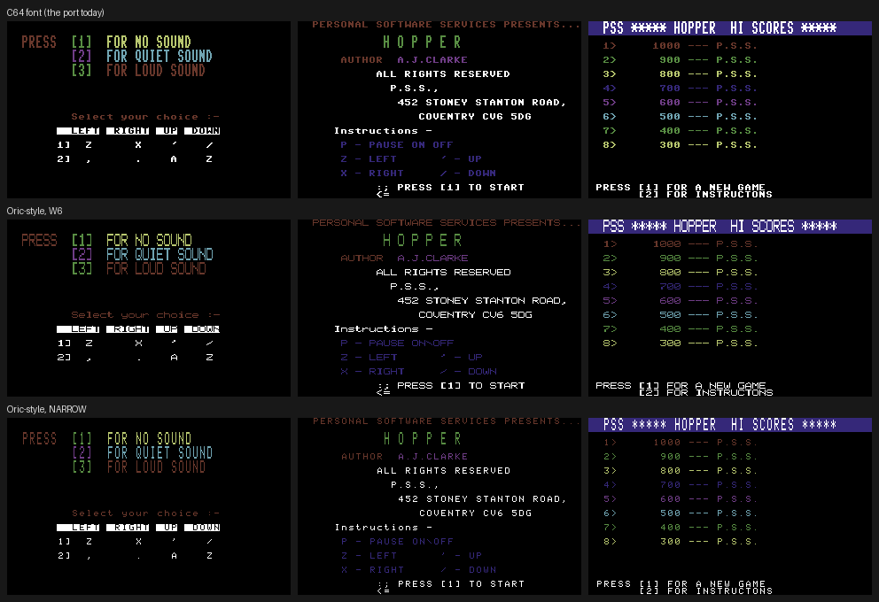
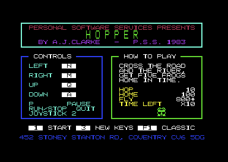
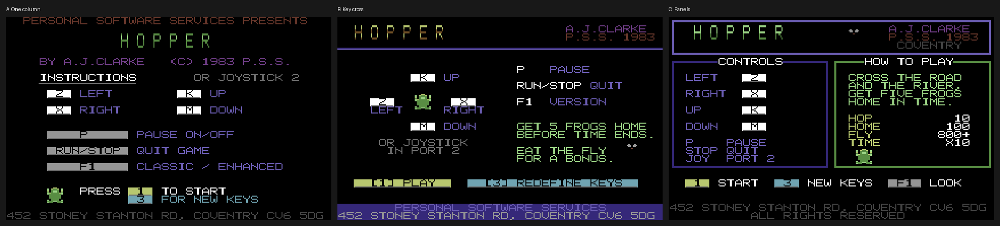

# Hopper – Enhanced Graphics

Every visual change in the C64 Enhanced version ([enhanced.md](enhanced.md)), one section per change: what the player
sees, what it is made from, and how the platform layer shows it. Each section says whether the change is built. Built
changes are shown in VICE captures; the rest of the pictures are mock-ups drawn from the real game screens by
`docs/tools/render_enhanced.py` ([enhanced.md](enhanced.md#how-the-mock-ups-are-made)). Where the change touches the
platform layer, the routines are described in [enhanced_platform.md](enhanced_platform.md).

---

## What Stays the Same

The screen layout, the text and where it is printed, the lane colours, the frog's drawing and every shape the game
defines in `udg_graphics`, `udg_symbols`, `frog_gfx`, `home_gfx`, `splat_gfx` and `turtle_frames`. The 28 Oric rows are
still shown on 25, with the same rows hidden per screen ([porting.md](porting.md#decisions)). Text rows (the status
line, menus, credits, signs) stay hires. Enhanced redraws the graphics characters, adds sprites over them, and adds
colour to the background.

The close-up below shows several changes together: multicolour logs and cars, the river texture, tufts on the verge, and
the road markings between the car lanes.

---

## V1 – Multicolour Lane Graphics

**Built** (`c64/src/enhanced.s`), checked in VICE. Logs, turtles, trucks, cars and the hedge keep their shapes but gain
a shade and a highlight. Each lane keeps the ink the original gives it.

**How the graphics are made.** At the start of each Enhanced game the platform converts the game's own glyphs, as the
port draws them (6 pixels widened to 8), into a second character set at `CHARSET_MC` (`$8800`). Multicolour pixels go in
pairs. A pair with both pixels set takes the cell's colour RAM, which is the lane's ink. A pair with one pixel set takes
`$D022`, the shade. In the top row of characters of each lane, the topmost full pair in each pixel column takes `$D023`,
the highlight, so the top outline of a log or car catches the light and the grain inside it doesn't. The hedge
(character `$7F`) is the one drawn glyph: the original's dither pattern turns into stripes in multicolour, so it becomes
a leaf pattern. The conversion runs on the C64 (`McBuild`, `McChar`, about 30,000 cycles once per game), so there is no
generated data to keep in step with the game.

| Lane (rows)          | Ink (colour RAM) | Shade (`$D022`) | Highlight (`$D023`) |
|:---------------------|:-----------------|:----------------|:--------------------|
| Hedge (0–2)          | green            | light green     | brown               |
| Logs, black (4–5)    | black            | brown           | orange              |
| Turtles (7–8)        | red              | brown           | light red           |
| Logs, yellow (10–11) | yellow           | orange          | white               |
| Logs, red (13–14)    | red              | brown           | light red           |
| Trucks (17–18)       | cyan             | grey            | white               |
| Cars, blue (20–21)   | blue             | grey            | white               |
| Cars, yellow (23–24) | yellow           | grey            | white               |

The colours are `LaneShade` and `LaneLight` in `enhanced.s`, per Oric row. A multicolour cell's colour RAM can only take
colours 0–7, which are exactly the Oric's eight inks, so every lane keeps its own ink. The black logs therefore stay
black and get brown grain (an earlier plan made them brown, which colour RAM can't show). All three road lanes share
grey and white, so the raster interrupt's writes never change colours between two vehicles' rows.

**How it is shown.** In multicolour text mode a cell is multicolour only if its colour RAM is 8 or more. Text rows keep
colour RAM below 8 and stay hires, so while an Enhanced game is on (`zMcPlay`) the frame interrupt sets multicolour mode
for the whole screen. Lane rows are simple rows (attributes only in columns 0–1): when `FastRow` colours one, or
`ParseRow` finds one simple, `McRowSetup` gives it the ink + 8, the multicolour character set (`CS_MC`) and the lane's
shade and highlight (`rowMc1`, `rowMc2`). The raster interrupt already sets `$D021` and `$D018` at the end of each row,
and now sets `$D022` and `$D023` too.

**Keeping up with the game.** The game rewrites three groups of glyphs while it plays. The platform converts them again
when they change, so no game byte is patched. The two hooks the plan expected aren't needed:

| Glyphs                 | Rewritten by                         | Noticed by                          |
|:-----------------------|:-------------------------------------|:------------------------------------|
| Turtles `$6E`–`$73`    | `SetTurtleFrame`                     | `turtle_frame` changing             |
| Frog `$3A`–`$3D`       | `SetFrogGfx`, the splat, a home frog | Its 32 bytes, compared every pass   |
| Home frogs `$2B`–`$2F` | `DrawHomeFrog`                       | Compared every 8th pass             |
| Everything else        | `InitGame`                           | Sentinel glyphs `$21`, `$61`, `$75` |

`McDynamic` does this from `Present` and costs about 600 cycles a pass when nothing changed. The sentinels are there
because the set is first built when the play screen's row map is set, before `InitGame` copies the game's graphics in.

**The death flash** changes the papers in columns 0–1, so the lanes stay multicolour through it, on white or black
paper.

---

## V2 – Sprite Frog with Hop Arc

**Built** (`c64/src/sprites.s`), checked in VICE. The frog is a sprite: a multicolour body (green, light green, a yellow
top edge) with a hires black outline sprite round it, so it stands out on the green verge and the yellow median. A hop
glides to its new place over a few frames on a low arc instead of jumping two columns at once. On the river the frog
rides its log or turtle with the lane's fine scroll (V4). Death shows the original splat as a sprite.

**How it is made.** `tools/frog_sprites.py` (`make c64-sprites`) reads the four directions from `frog_gfx` and the
splat from `splat_gfx` on the tape, widens them to 8 pixels a character as the port shows them, converts them to
multicolour as in V1 and draws the outline round them, writing `c64/src/sprites.inc`. Five frames of two sprites, ten
blocks from `$8400`. The mock-up's stretched hop frame is left out: the arc alone reads well at this size.

**How it is shown.** The game still writes the frog's characters (`$3A`–`$3D`) into the screen and reads the cells under
them (`under_frog`), so collision is untouched. Only their glyphs are blank: `SetFrogGfx` (patched at its start,
`SetFrogGfxC64`) records the direction as the sprite's frame instead of drawing it, and `SetSplatGfx`'s `jsr DrawFrog`
(`SplatDrawC64`) does the same for the splat. At the end of each `Present`, `SprTarget` turns `frog_pos` into a sprite
position through the play row map, the same moment the lanes' characters and fine scroll are copied, and adds the
lane's fine scroll on the river. The frame interrupt's `SprTick` moves the sprite there: a move of 3 pixels or less
(riding) is taken at once, a hop halves the distance each frame under a 6-frame arc (`HopLift`), and a move of more than
4 characters (a new frog after a death or a home) is taken at once. The sprites hide on the sheet-start signs, whose
rows start with a character.

With the frog a sprite, V4 no longer holds back the road lane the frog stands in: the hidden character frog doesn't
show, so the traffic glides past the frog. The frog never shares a row with more than one other sprite (the fly is in
the home row), so no multiplexing is needed.

---

## V3 – Fly Sprite

**Built** (`c64/src/sprites.s`), checked in VICE on sheet 3. The fly in a home flaps its wings (two frames, every 4
frames) and bobs by a pixel (every 8). It is two hires sprites, a black body and light grey wings, from the mock-up's
drawing; the mock-up's red eyes are left out, since each hires sprite has one colour. `SprTarget` shows it where the
game has drawn its first character (`$7C`) at `fly_ptr`; the game's `fly_on` doubles as a copy pointer elsewhere, so the
screen cell is the test. The fly's characters stay on the screen for the game to read, with their glyphs blank
(`McBuild` clears them).

---

## V5 – Water and Grass Texture

**Planned** (Showcase tier), not built yet: the pictures here are mock-ups.

**What changes.** The river's empty water shows sparse light-blue ripples. The verges (the yellow median and the green
start) show small tufts. The ripples belong to the lane they are in, so they drift with the logs and turtles, and the
river looks like it flows. Every few frames the ripple glyphs swap between two phases, so they shimmer.

**How it is shown.** All of this is the space character (`$20`), which the game writes for open water and grass and
tests for drowning. `Present` translates `$20` per row as it copies the Oric screen: to a ripple character on river
rows, a tuft character on verge rows, and to itself elsewhere. The new glyphs use character codes `$00`–`$1F`. The Oric
never shows those codes as glyphs, because they are serial attributes, so they are free in the C64 character set. The
translation costs about 4,000 cycles a frame, inside the time the Oric spent waiting in `FrameDelay`
([porting.md](porting.md#decisions)).

---

## V6 – Road Markings

**Built**, checked in VICE. The Oric drew dashed lines between the car lanes on rows 19 and 22. The port hides those
rows to fit 28 rows on 25, so the three car lanes sit together. Enhanced draws a one-pixel grey line at each boundary
instead, without spending a row. It is solid, not dashed: a raster colour change covers the whole line.

**How it is shown.** The row interrupts for Oric rows 20 and 23 start the row with `$D021` grey and turn it back after
its first raster line, the lane boundary ([enhanced_platform.md](enhanced_platform.md#raster-interrupt)). Only the
background takes the colour, so a car passing over the line hides it, as a car would. The lines are drawn only while
those rows show lanes, so the sheet-start signs, which use the same rows, are left alone. The `enh-play` capture under
V1 shows them.

---

## V7 – Oric-Style Font

**Built** (`W6` layout), checked in VICE. The port shows text in the C64 font, because the Oric ROM font isn't on the
tape ([porting.md](porting.md#known-differences)). Enhanced uses a font drawn in the manner of the Oric's text: a 5 × 7
design with single-pixel strokes in a 6-pixel cell, the left column as the gap, and lower case with descenders in row 7.
It is drawn for this project, not copied from the Oric ROM. It covers every screen's text: the menus, the redefine
prompts, the credits, the hi-score table and title, the signs and the status line.

The glyphs are text art in `tools/oric_style_font.py` (`#` set, `.` clear), one block per ASCII code `$20`–`$7F`, so
they can be edited in any editor. `make c64-font` writes `c64/src/oricfont.inc` from it.

**Layout.** The 6-pixel cell has to fill the C64's 8 pixels. Two ways were drawn for review, and `W6` was chosen:

| Layout   | How                                                     | Looks                                          |
|:---------|:--------------------------------------------------------|:-----------------------------------------------|
| `W6`     | The two middle pixels doubled, as the game's glyphs are | Matches the game's graphics; M, W, A lean left |
| `NARROW` | The 6 pixels as drawn, a blank column each side         | Crisper; not used                              |

**Readability.** Single-pixel strokes in the C64's dark blue and red are harder to read on black than the C64 font's
two-pixel strokes (the blue instruction lines on the credits). This is accepted for now, as the Oric looked: the
alternatives, if it proves a problem on a real screen, are to thicken the vertical strokes for those inks only or to
keep the C64 font for blue and red text.

**How it is shown.** `BuildFont` builds the C64 font at start-up as before, then `KeepC64Font` copies it to
`C64FontCopy` and `SetFont` puts the font of the chosen version into `CHARSET` codes `$20`–`$7F`. `ColdStart` then saves
that to `$3100` as usual, and `RestoreCharset` brings it back for every menu. A flip on the instructions page calls
`SetFontC64`: the screen is blanked, `SetFont` copies the other font in (from RAM, so the character ROM needn't be
banked in and interrupts stay on), the copy at `$3100` is updated, `RefreshCharsets` rebuilds the inverse and
double-height sets, and the screen comes back, a couple of frames later. The font data (768 bytes) is in `HIDATA`, and
the C64 copy (768 bytes) at `$C800`–`$CAFF` in bank 3 RAM ([enhanced_platform.md](enhanced_platform.md#memory)).

---

## F3 – Enhanced Instructions Page

**Built** (`EnhancedPage` in `c64/src/platform.s`, the page from `tools/instructions_page.py`), checked in VICE.

**What changes.** In Enhanced the credits and instructions are one page, drawn at once instead of laid down by the
hopping frog: the title framed with the PSS line and the author, a CONTROLS panel with the four chosen keys as keycaps,
P, RUN/STOP and the joystick, a HOW TO PLAY panel with the aim and the points, and below them the 1 (start), 3 (new
keys) and F1 (Classic) buttons and the PSS address on one line. The title frog and the jingle are the original's
(`CreditsEnd`). Of three mock-ups (one column, a key cross, panels) layout C was chosen.

**How it is shown.** The page is an ordinary Oric screen, so the port draws it as it draws the original: ink attributes
for the colours, inverse characters for the keycaps and buttons, the double-height attribute for the title (a row is
double height as a whole, so the title rows hold only the title and the box sides). The tool packs the 28 rows with the
picture's RLE (635 bytes, `instrpage.inc`); `EnhancedPage` unpacks it into `SCREEN` with `Unpack`, puts the four key
names (from the credits text, where `ControlsMenu` keeps them) into the keycaps, and sets `versionShown` so F1 works.
The frames are drawn in six characters no page text or key name uses (`{` `}` `` ` `` `#` `~` `|`):
`LendPageGlyphs` puts line pieces in those codes while the page is up, and `SetRowMap` puts the font's glyphs back on
the next screen (`ReturnPageGlyphs`). The game reinstalls its own graphics in those codes when a game starts.
`InitGameC64` clears the screen first, so the page never shows with the codes handed back.

---

## F1 – Enhanced Attract Screen

**Built** (`AttractStart`, `AttractPresent` in `c64/src/sprites.s`), checked in VICE.

**What changes.** In Enhanced the hi-score screen of the attract loop comes alive: the title's letters roll through a
colour cycle, thin lines run under the title and round a scroller (`HOPPER - BY A.J.CLARKE - P.S.S. 1983 - NOW ON THE
COMMODORE 64 - PRESS 1 TO PLAY...`), and the sprite frog hops along the empty row under the table. The table and the
prompts stay where the game prints them; Classic and the name-entry table are unchanged.

**How it is shown.** No raster changes: the row interrupt has no cycles to spare, so the mock-up's colour per raster
line became a colour per letter. `TitleTickC64` calls `AttractStart` on the screen's first tick: it draws the lines in
the page's borrowed `~` glyph (rows 2, 23 and 25; `LendPageGlyphs`), sets up the V2 frog sprites and sets `attractOn`.
`Present` parses the title rows first; right after row 1 (`ParseRowAtt`) `AttractTitle` writes the cycle into their
colour RAM, (`zTick` / 2) mod 12 rolling along, and the round-robin parse skips them while `attractOn` is set. At the
end of `Present`, `AttractPresent` runs the frames since its last call: the scroller, one pixel a frame through row
24's `$D016` (its `rowCtl2`, in 38 columns so the jumps at the edges are hidden), shifting the Oric and VIC rows
together each eighth pixel; and every 25 frames the frog's next hop, two columns along row 19, which the frame
interrupt (`SprTick`, run while `attractOn` too) eases in with its arc. The scroller is on row 24, not the mock-up's
23, so the frog's sprite DMA is over before the scroller row's interrupt. `SetRowMap` clears `attractOn`, and
`SprSetup` and `ReturnPageGlyphs` take the sprites and the `~` away. About 450 bytes in `HIDATA`, made room for by
moving `C64FontCopy` to `$C800` (bank 3 RAM, filled at start-up, not in the `.prg`).

---

## V4 – Smooth-Scrolling Lanes

**Built** (`FineRow` in `c64/src/enhanced.s`), checked in VICE. Logs, turtles and traffic glide a pixel or two a frame
instead of jumping eight pixels at a time. The game still moves each lane one character per step; between steps each
lane row is shifted 0–7 pixels with the `$D016` fine scroll, so the step lands where the scroll had got to.

**How it is shown.** The study turned out simple: each pass of `MainLoop` counts every lane's `lane_timer` up to its
speed in `lane_speeds`, then steps the lane and sets the timer to 0. So the offset is the timer's share of the wait,
round(timer × 8 / speed), from a 256-byte table (`FineTab`, speed × 16 + timer); the sheet speed-ups need nothing
extra, since they only lower `lane_speeds`. `XSCROLL` only shifts right, so a lane that moves left counts down from 7
instead of up from 0 (`LaneLeft`). `Present` works out each lane row's `$D016` value just before it copies the row and
stores it in `rowCtl2` just after, so the characters and the offset change together; the raster interrupt writes
`rowCtl2` for every row.

**The frog.** On the river the frog is carried by its log or turtle, so it glides with it. On the road the frog is
drawn in the lane's own characters but doesn't move with the traffic. Before V2 the road lane the frog stood in stepped
by whole characters for that reason; with the sprite frog the characters are blank, so every lane glides.

**The edges.** The shifted rows push up to 7 pixels into the margin on the right and leave the row's paper on the left.
The margins are the row's paper anyway ([porting.md](porting.md#decisions)), so nothing ragged shows.

---

## Memory for the Graphics

| Item                                    | Where           | Size                     |
|:----------------------------------------|:----------------|:-------------------------|
| Multicolour play character set (V1, V5) | `$8800`–`$8FFF` | 2,048 B                  |
| Multicolour turtle frames (V1)          | code area       | 336 B                    |
| Frog sprites, body and outline (V2)     | `$8400`–`$87FF` | 1,024 B                  |
| Splat, splash and fly sprites (V2, V3)  | `$B800`–`$B9FF` | 512 B                    |
| Oric-style font (V7)                    | `CHARSET`       | 0, replaces the C64 font |

The sprites and the character set must be where the VIC can see them in bank 2, and not in `$9000`–`$9FFF`, where the
VIC sees the character ROM ([enhanced_platform.md](enhanced_platform.md#memory)).
