# Hopper – Screens and Graphics

The Oric figures here are decoded from the tape by `docs/tools/render_graphics.py`. The screens are drawn by the game's
own routines running on a 6502 core, then shown with the Oric's serial attributes. The C64 pictures are VICE captures
of the port, taken by `docs/tools/capture_screens.py` ([html_documentation.md](html_documentation.md)).

---

## The Oric Screen

*Hopper* runs in the Oric's TEXT mode: 40 columns by 28 rows at `$BB80`, with characters 6 pixels wide and 8 high from
the character set at `$B400`. Colour comes from **serial attributes**. A byte below `$20` isn't a character; it changes
the ink, the paper or the mode (double height, blink) from that cell to the end of the row, and shows as a cell of
paper. Bit 7 of a character inverts it. The game draws by storing bytes into the screen and checks collisions by
reading them back ([architecture.md](architecture.md)).

Every playfield row starts with an ink and a paper attribute in columns 0–1 (`row_colours`), so the game itself uses
columns 2–39.

| Screen          | Drawn by                                             | Figure                                                 |
|:----------------|:-----------------------------------------------------|:-------------------------------------------------------|
| Sound, controls | `SoundMenu`, `MarkSoundChoice`, `ControlsMenu`       | [oric-menu.png](images/graphics/oric-menu.png)         |
| Credits         | `CreditsIntro`                                       | [oric-credits.png](images/graphics/oric-credits.png)   |
| Hi-scores       | `DrawTitleBar`, `DrawHiScoreTable`, `DrawMenuPrompt` | [oric-hiscores.png](images/graphics/oric-hiscores.png) |
| Sheet start     | `DrawScenery`                                        | [oric-scenery.png](images/graphics/oric-scenery.png)   |
| Play            | `InitGame`                                           | [oric-game.png](images/graphics/oric-game.png)         |
| Game over       | `GameOver`                                           | [oric-gameover.png](images/graphics/oric-gameover.png) |

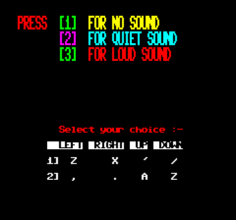

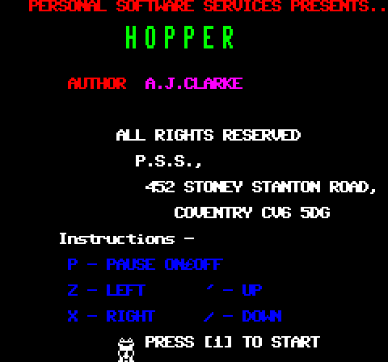

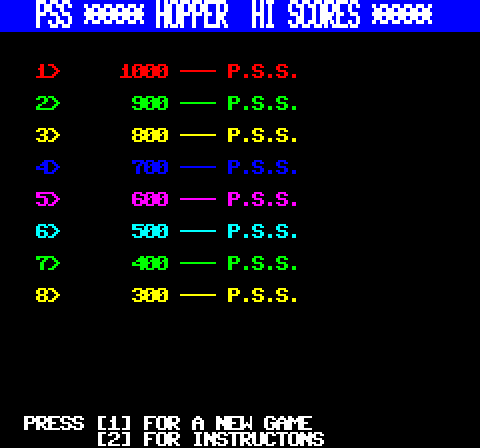

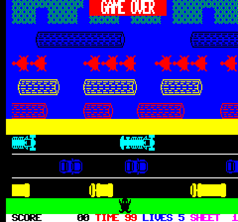

The Oric ROM font isn't on the tape, so the letters in these figures come from the C64 character ROM, narrowed to 6
pixels. The game's own graphics are exact.

---

## Redefined Characters

`InitGame` copies the game's graphics over the ROM font: `udg_graphics` goes to characters `$5B`–`$7F` (scenery, logs,
cars, snake, turtles, fly) and `udg_symbols` to `$21`–`$2A`. The frog is characters `$3A`–`$3D`, loaded for each
direction by `SetFrogGfx`, and the frog sitting in a home is `$2B`, `$2C`, `$2E`, `$2F` (`DrawHomeFrog`). The ROM font
is saved to `$3100` at cold start and put back by `RestoreCharset` for the menus.

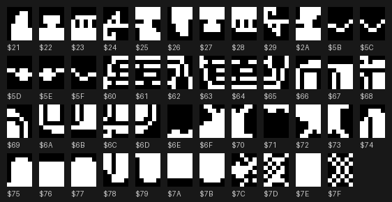

Here's the frog facing up, down, left and right (`frog_gfx`, 32 bytes per direction, laid out 2×2):

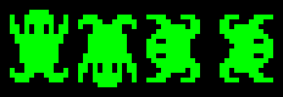

And the frog home (`home_gfx`), beside the squashed frog of the death sequence (`splat_gfx`):

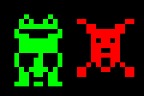

---

## The Diving Turtles

The turtles are three characters wide and two high (`$6E`–`$73`). `SetTurtleFrame` copies one of seven frames from
`turtle_frames` into those characters, so every turtle on the lane changes at once, and `AnimateTurtles` steps the
frames down to 6 and back. Frames 5 and 6 are under water, and `CheckTurtleDive` drowns a frog standing on them.

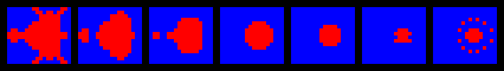

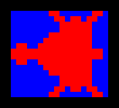

---

## The C64 Version

The C64 shows the same Oric screen. `Present` copies 25 of its 28 rows to the VIC-II text screen and turns the serial
attributes into colour RAM, per-row background colours set by a raster interrupt, and per-row character sets for double
height ([platform_layer.md](platform_layer.md#video)). The game's glyphs are widened from 6 to 8 pixels by doubling the
two middle pixel columns (`W6`).

| Capture                                             | Shows                                     |
|:----------------------------------------------------|:------------------------------------------|
| [sound-menu.png](images/screens/sound-menu.png)     | The sound menu                            |
| [redefine.png](images/screens/redefine.png)         | Redefining the keys                       |
| [credits-done.png](images/screens/credits-done.png) | The credits, with the redefined key names |
| [hiscores.png](images/screens/hiscores.png)         | The hi-score table (Classic)              |
| [enh-hiscores.png](images/screens/enh-hiscores.png) | The hi-score table in Enhanced (V7 font)  |
| [instructions.png](images/screens/instructions.png) | The Enhanced instructions page (F3)       |
| [enh-play.png](images/screens/enh-play.png)         | Play in Enhanced: multicolour lanes       |
| [enh-road.png](images/screens/enh-road.png)         | Enhanced: the frog crossing the road      |
| [enh-later.png](images/screens/enh-later.png)       | Enhanced: riding the turtles              |
| [enh-ride.png](images/screens/enh-ride.png)         | Enhanced: on the top log                  |
| [enh-hops.png](images/screens/enh-hops.png)         | The death flash in Enhanced               |
| [sheet-start.png](images/screens/sheet-start.png)   | The sheet-start signs                     |
| [play.png](images/screens/play.png)                 | Play                                      |
| [hops.png](images/screens/hops.png)                 | The death flash                           |

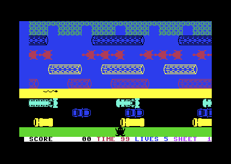

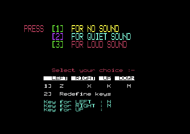

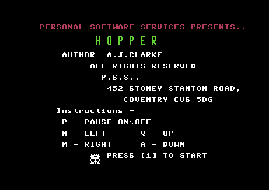

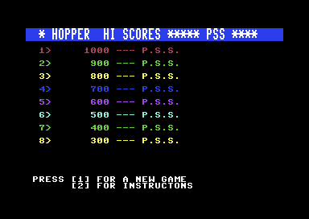

### The C64 Start-Up Picture

This one isn't in the Oric game. It's a multicolour bitmap made from the cover painting and the PSS logo, shown at
start-up and between the hi-scores and the credits. How it was made, and how to edit its master `c64/art/intro.png`,
is in [porting.md](porting.md#decisions).

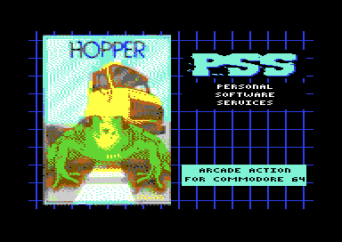

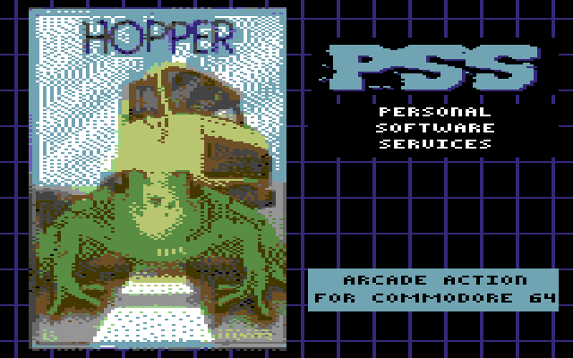
