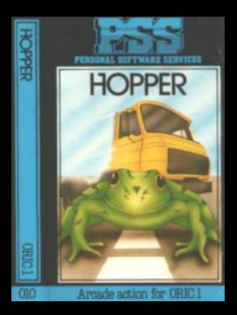
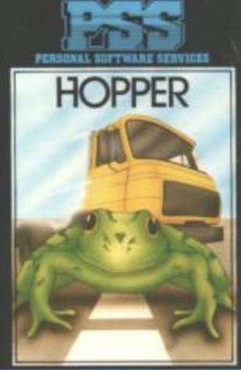
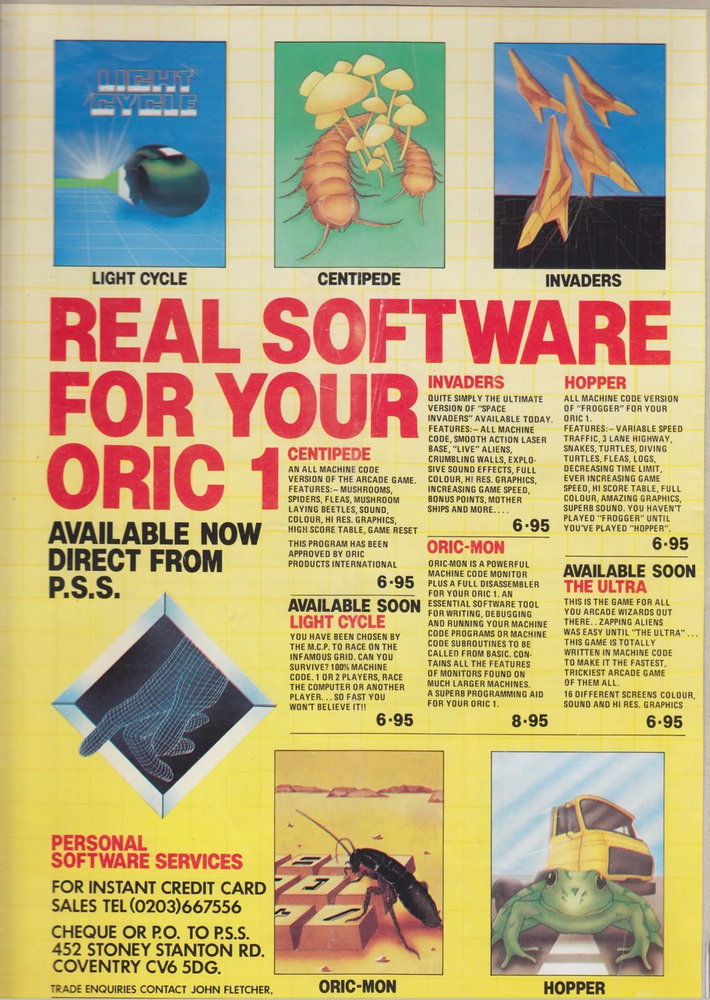

# Hopper – The Original Release

---

## The Game

I wrote *Hopper* for the Oric-1, and PSS (Personal Software Services, 452 Stoney Stanton Road, Coventry) published it
on cassette in 1983, alongside my other Oric game, [*Light Cycle*](https://github.com/anthonyjclarke/Light-Cycle-Oric).
The game's own credits name me as the author and PSS as the publisher. Everything in this repository starts from the
tape image `original/HOPPER.TAP`.

---

## The Cassette

The front of the inlay has the PSS logo, the title, a frog in front of a lorry, and "Arcade action for ORIC 1" with the
catalogue number 010 on the strip below. The spine carries the title and "ORIC 1".

This is a straight scan of the cover painting. The C64 start-up picture is made from it
([graphics.md](graphics.md#the-c64-start-up-picture)).

---

## The PSS Advert

PSS ran a full-page advert, "Real Software for your Oric 1", with the *Hopper* cover bottom right. It lists the game at
£6.95 among the titles available now, beside Centipede, Invaders and the Oric-Mon monitor, with *Light Cycle* and *The
Ultra* "available soon". The blurb calls Hopper an all machine code version of *Frogger* for the Oric 1, with variable
speed traffic, a three-lane highway, snakes, turtles, diving turtles, fleas (the fly), logs, a decreasing time limit,
ever increasing game speed, a hi-score table, full colour and sound.

Everything the advert lists is there in the code: three road lanes, the snake on the middle bank, diving turtles from
sheet 2, the fly from sheet 3, the TIME limit, the speed-ups as sheets are cleared, and the eight-entry hi-score table
([player_guide.md](player_guide.md)).
