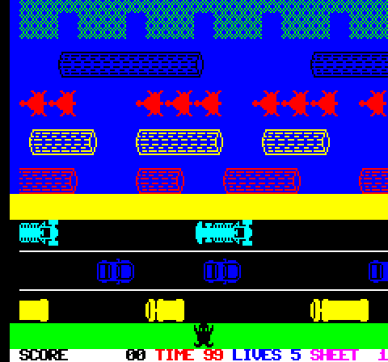
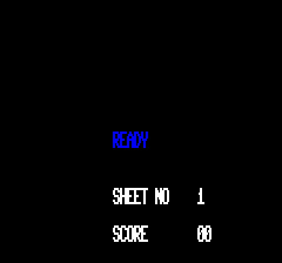

# Hopper – Player's Guide

Everything here comes from the code (`src/hopper.s`) unless it says otherwise. Numbers in frames are passes of the main loop, and one pass takes about 30 ms on the Oric
([architecture.md](architecture.md#timing)).

---

## Starting Up

The tape autoruns. Two menus come first, once only; they come back only after the RESET button (RESTORE on the C64).

| Screen   | Keys    | Does                                                                |
|:---------|:--------|:--------------------------------------------------------------------|
| Sound    | 1, 2, 3 | No sound, quiet sound, or loud sound (the AY volumes doubled)       |
| Controls | 1, 2    | Chooses the control keys (below); the instructions take their names |

Then the attract cycle starts. A frog hops round the screen leaving the credits and instructions behind it, they stay up
for about 18 seconds, and then the hi-score table follows with its title scrolling. On either screen, **1** starts a
game and **2** shows the instructions again. On the C64, **3** redefines the keys, and the instructions say so.

On the Oric the hi-score screen stays until you press a key. The C64 version moves on after about 15 seconds to its
start-up picture, then the credits again ([porting.md](porting.md#decisions)). On the C64 instructions page, **F1**
picks the **Classic** or **Enhanced** look and shows the page again in it; it does nothing on other screens
([enhanced.md](enhanced.md#the-version-switch)).

---

## Controls

| Machine | Choice | Left                                 | Right | Up | Down | Pause |
|:--------|:-------|:-------------------------------------|:------|:---|:-----|:------|
| Oric    | 1      | Z                                    | X     | '  | /    | P     |
| Oric    | 2      | ,                                    | .     | A  | Z    | P     |
| C64     | 1      | Z                                    | X     | K  | M    | P     |
| C64     | 2      | Redefined: the player picks all four |       |    |      |       |

On the C64, joystick port 2 works with either choice. **Redefine keys** asks for left, right, up and down in turn under
the menu. If it can't take a key (P, SPACE, a key already chosen and a few more), it shows **CAN'T USE** in red and
waits for another ([remix.md](remix.md)).

A held key moves the frog once, because `GetMove` ignores a direction that's still held from the last hop. **P** pauses
and silences the sound, and P again carries on. In play, the RESET button (RESTORE) goes back to the sound menu and
keeps the hi-scores. On the C64, **RUN/STOP** ends the game at once: GAME OVER, the hi-score check, then the hi-score
table ([remix.md](remix.md)). The C64 credits list it with the other keys. **F1** on the instructions page switches
between Classic and Enhanced.

---

## The Screen

From the top there are the five homes in a hedge (rows 1–2), the river (rows 4–14), the middle bank where the snake
runs (row 15), the road (rows 17–24) and the start bank (row 25). Row 27 is the status line, with SCORE, TIME, LIVES
and SHEET.

| Lane    | Rows  | Carries             | Moves | Every (frames, at the start) |
|:--------|:------|:--------------------|:------|:-----------------------------|
| River 1 | 4–5   | Logs                | Right | 6                            |
| River 2 | 7–8   | Turtles (they dive) | Left  | 13                           |
| River 3 | 10–11 | Logs                | Right | 7                            |
| River 4 | 13–14 | Logs                | Left  | 5                            |
| Road 1  | 17–18 | Vehicles            | Left  | 7                            |
| Road 2  | 20–21 | Vehicles            | Right | 5                            |
| Road 3  | 23–24 | Vehicles            | Left  | 11                           |

The frog hops two text rows at a time, so it's one hop per lane. Logs and turtles carry it, and the road lanes are drawn
around it.

---

## Dying

| Cause                                                 | Checked by                         |
|:------------------------------------------------------|:-----------------------------------|
| Hopping into anything on the road, or being run over  | `CheckRoadHit`, the road scrollers |
| Landing in the water, not on a log or turtle          | `CheckLanding`                     |
| Standing on the turtles while they are under water    | `CheckTurtleDive`                  |
| Being carried off the side of the screen              | `CheckFrogBounds`                  |
| Hopping into the hedge or a home that is already full | `CheckFlyEaten`                    |
| TIME reaching 00                                      | `CheckTimeLow`                     |

Each death plays the squashed-frog flash and a falling tone, costs a life, and puts the frog back on the start bank. The
game starts with five lives, and when they're gone it's GAME OVER, then the hi-score check.

---

## Scoring

The status line shows the score with a fixed last digit, so every score is a multiple of 10.

| Event                                | Points                                   |
|:-------------------------------------|:-----------------------------------------|
| A hop up                             | 10                                       |
| A frog home                          | 100                                      |
| Eating the fly in a home             | 800–1100, counted in with beeps (random) |
| Clearing the sheet (fifth frog home) | 10 for every unit of TIME left           |

TIME starts at 99 and counts down one unit every 32 periods of the game's timer, which is about 0.79 s. Below 10, a
warning tone sounds with each unit. There's one TIME for the whole sheet: it isn't reset for each frog, only at a new
sheet and when it runs out (which costs a life).

---

## Sheets

Five frogs home clears the sheet. You get the time bonus, then the READY / SHEET NO / SCORE signs and the sheet tune,
and then a harder sheet.

| From sheet  | Change                                                                |
|:------------|:----------------------------------------------------------------------|
| 2           | The turtles start diving                                              |
| 3           | A fly appears in a random empty home for a while, worth the fly bonus |
| 3 and 7     | Every lane moves one frame faster (none faster than every 3 frames)   |
| 7, 15, 23 … | The snake and the turtles speed up, and the whole game a little       |

---

## Hi-Scores

The table holds eight scores, all `P.S.S.` to start with (1000 down to 300). A score that beats one of them asks for a
name, typed on the keyboard; DEL rubs out and RETURN ends it. On the Oric the table sits in spare character-set memory,
so it survives the RESET button (but not a reload). The C64 keeps it at the same address.
